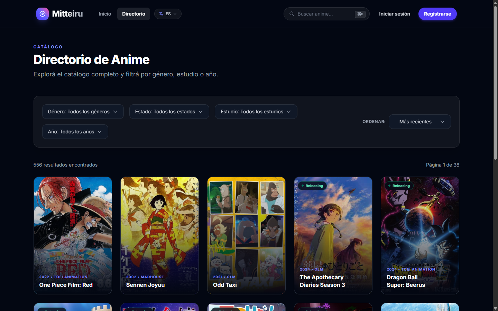

# Mitteiru Frontend

Interfaz web de Mitteiru: catálogo, reproductor, perfiles, listas, historial, reseñas y panel de administración.

Construida con **SvelteKit 2 + Svelte 5 (runes) + Tailwind CSS 4 + TypeScript**. SvelteKit hace SSR y actúa como BFF: el navegador solo habla con este servidor y nunca ve el JWT del backend.

> Documentación completa del proyecto, arquitectura y puesta en marcha del backend: **[README raíz](../README.md)**.



## Stack

| Pieza | Versión / uso |
|---|---|
| Framework | SvelteKit 2, Svelte 5 con runes |
| Estilos | Tailwind CSS 4, tokens propios en `src/routes/layout.css` |
| Lenguaje | TypeScript en modo `strict` |
| Build | Vite 8 |
| Tests | Vitest y Playwright |
| Video | `dashjs` para DASH; video nativo y embeds externos |
| Markdown | `marked` + `isomorphic-dompurify` |

## Requisitos

- Node.js 22+ y npm 10+.
- El [backend](../Mitteiru-backend) corriendo y accesible.
- Chromium para Playwright: `npx playwright install chromium`.

## Puesta en marcha

```bash
cd mitteiru-frontend
cp .env.example .env
# API_URL=http://127.0.0.1:8000
npm ci
npm run dev
```

La app queda en `http://localhost:5173`.

En Windows usá `Copy-Item .env.example .env`.

## Variables de entorno

| Variable | Obligatoria | Default | Descripción |
|---|---|---|---|
| `API_URL` | No | `http://127.0.0.1:8000` | URL privada del backend. Solo la usa el servidor. |
| `PUBLIC_API_URL` | No | — | Fallback legacy; el navegador ya no la usa. |
| `PUBLIC_EMBED_HOSTS` | No | vacío | Hosts permitidos para iframes, separados por coma. Vacío = cualquier `http/https` (siempre se valida el protocolo). |

## Scripts

| Comando | Qué hace |
|---|---|
| `npm run dev` | Servidor de desarrollo. |
| `npm run build` | Build de producción. |
| `npm run preview` | Previsualiza el build. |
| `npm run check` | `svelte-check` + TypeScript. |
| `npm run check:watch` | Igual, en watch. |
| `npm run test:unit` | Tests unitarios (Vitest). |
| `npm run test:e2e` | Tests E2E (Playwright). |

## Estructura

```text
src/
├── routes/
│   ├── +layout.svelte          # navbar, progreso de ruta, toasts, View Transitions
│   ├── +page.svelte            # home
│   ├── directory/              # catálogo con filtros y paginación
│   ├── search/                 # resultados de búsqueda
│   ├── anime/[id]/             # ficha, episodios y reseñas
│   │   ├── episode/[episodeId]/
│   │   └── review/
│   ├── lists/                  # listas del perfil
│   ├── history/                # historial filtrable
│   ├── login/ · signup/        # auth con form actions
│   ├── selectprofile/          # selección y gestión de perfiles
│   ├── admin/                  # panel de anime, episodios y fuentes
│   └── api/[...path]/          # BFF: proxy same-origin al backend
├── lib/
│   ├── api/client.ts           # cliente HTTP tipado
│   ├── server/api.ts           # API_URL y cliente server-side
│   ├── components/
│   │   ├── layout/             # Navbar, LanguageSelector
│   │   ├── anime/              # AnimeCard, EpisodeCard, skeletons
│   │   ├── ui/                 # Button, Modal, Toaster, SearchBar...
│   │   ├── admin/              # SourcesPanel
│   │   └── comments/
│   ├── actions/                # modal, reveal, imageError
│   ├── stores/toast.ts
│   ├── i18n/index.ts
│   ├── utils/motion.ts
│   └── types/
├── app.html
├── app.d.ts
├── hooks.server.ts             # sesión desde cookies y headers de seguridad
└── routes/layout.css           # tokens, keyframes y utilidades
```

## Cómo funciona

1. **SSR + load functions.** Cada página obtiene sus datos en `+page.server.ts` con `serverApi(token)`, usando el token de la cookie `session`.
2. **BFF.** El navegador llama a `/api/*`; `src/routes/api/[...path]/+server.ts` valida prefijos, origen y `Sec-Fetch-Site`, inyecta el `Authorization` y reenvía al backend. Las rutas de admin usan `adminToken`.
3. **Sesión.** `session` (12 h), `adminToken` (2 h) y `profileId` son cookies `HttpOnly`, `SameSite=Strict` y `Secure` en producción.
4. **CSP.** Definida en `svelte.config.js` con nonce; incluye hashes para los handlers inline que Svelte emite en SSR.
5. **Form actions.** Login y signup usan acciones de SvelteKit; el resto de mutaciones pasan por el cliente tipado.

### Mapa de rutas

| Ruta | Pantalla |
|---|---|
| `/` | Home con destacado y secciones. |
| `/directory` | Catálogo con filtros, orden y paginación. |
| `/search?q=` | Resultados de búsqueda. |
| `/anime/[id]` | Ficha, episodios y reseñas. |
| `/anime/[id]/episode/[episodeId]` | Reproductor, servidores y comentarios. |
| `/anime/[id]/review/new` | Editor de reseña con Markdown. |
| `/lists` | Listas del perfil activo. |
| `/history` | Historial filtrable. |
| `/login`, `/signup` | Autenticación. |
| `/selectprofile` | Selección y gestión de perfiles. |
| `/admin` | Alta de animes/episodios y fuentes externas. |

## Diseño y UX

- **Tokens:** superficies, acento indigo, radios, sombras, easings y duraciones en `layout.css`.
- **Movimiento:** `src/lib/utils/motion.ts` centraliza duraciones y easings; las cards, modales y menús comparten el mismo ritmo.
- **Feedback:** barra de progreso de navegación, skeletons con la forma del contenido, toasts accesibles, estados vacíos con acción y botones con `loading`.
- **Transiciones:** View Transitions con fallback y respeto de `prefers-reduced-motion`.
- **i18n:** español/inglés en `src/lib/i18n/index.ts`, con selector de idioma en navbar y menú móvil.
- **Accesibilidad:** foco visible, modales con Escape y trampa de foco, `aria-current` en navegación y etiquetas asociadas.

## Testing

```bash
npm run check
npm run test:unit
npm run test:e2e
```

Los E2E usan Playwright y, por defecto, levantan Vite en `127.0.0.1:4173`. Los tests de seguridad se saltan si no existen credenciales sembradas:

```env
E2E_USER_EMAIL=
E2E_USER_PASSWORD=
E2E_ADMIN_EMAIL=
E2E_ADMIN_PASSWORD=
E2E_BASE_URL=http://127.0.0.1:4173
```

Si el servidor no levanta en Windows, ejecutá `npm run dev -- --host 127.0.0.1 --port 4173` y luego `E2E_BASE_URL=http://127.0.0.1:4173 npm run test:e2e`.

## Convenciones

- Componentes con runes (`$state`, `$derived`, `$effect`, `$props`).
- TypeScript `strict`; evitar `any` en código nuevo.
- Una responsabilidad por componente; la lógica de datos vive en `+page.server.ts` o en `lib/`.
- Errores en los bordes, sin `catch` vacíos ni promesas flotantes.
- Commits con *Conventional Commits*.

## Enlaces

- [README raíz](../README.md)
- [Motor de fuentes](../docs/FUENTES.md)
- [Seguridad](../docs/security/threat-model.md)
- [Sidecar de fuentes](../Mitteiru-sources-browser/README.md)
